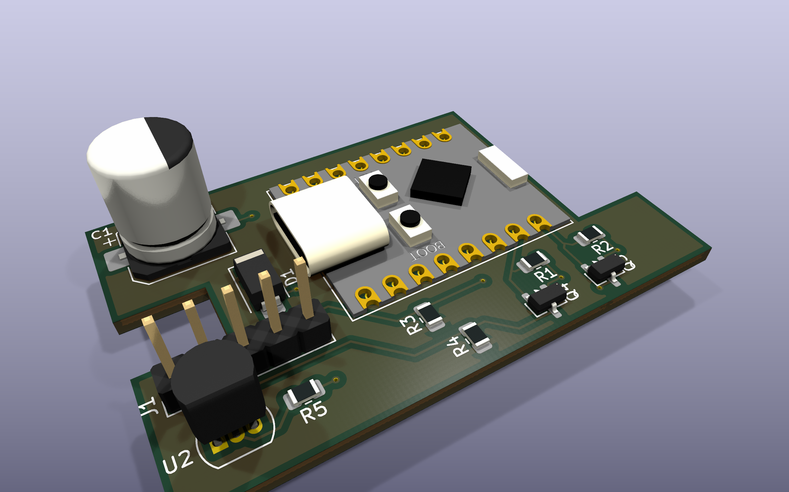
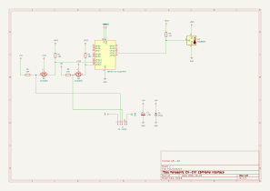
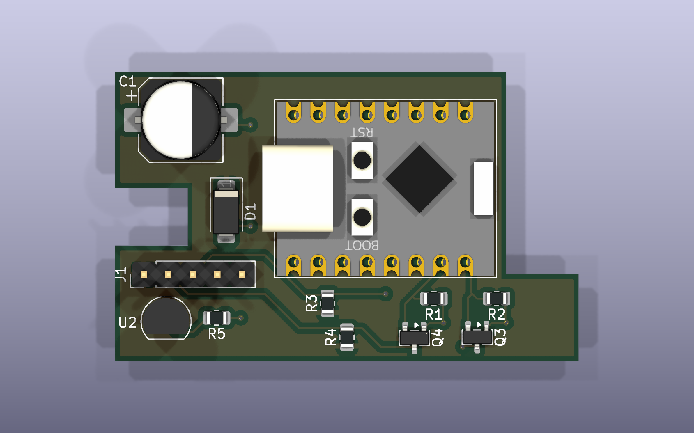

# P11 – ESPHome interface for Panasonic air conditioners and heat pumps (CN-CNT)

A small open-hardware board that connects a Panasonic air conditioner or air-to-air heat pump to
[Home Assistant](https://www.home-assistant.io/) through the indoor unit's **CN-CNT** service port.
It runs [ESPHome](https://esphome.io/) on an ESP32-C3 Super Mini with the
[`panasonic_ac`](https://github.com/DomiStyle/esphome-panasonic-ac) component. Everything stays
local: no Panasonic cloud and no Comfort Cloud adapter (CZ-TACG1).



This design is based on the
[Ingenious Makers ESPHome Panasonic Climate Interface](https://www.ingeniousmakers.com/index.php/2025/03/08/ingenious-makers-esphome-panasonic-climate-interface/).
Compared with the original, it:

- uses SMD parts throughout: AO3400A MOSFETs in place of 2N7000, US1A in place of 1N4001, 0805 resistors and an SMD electrolytic capacitor;
- adds an optional on-board **DS18B20** temperature sensor;
- is a 4-layer board with solid GND and 3.3 V inner planes.

## Features

- Full climate control from Home Assistant: mode, target temperature, fan speed and swing.
- Outdoor temperature, defrost status and live power consumption from the unit.
- Daily energy (kWh) calculated from the power reading.
- Optional room temperature from the on-board DS18B20.
- Powered from the unit's own 5 V on the CN-CNT port, so no extra power supply is needed.
- USB-C on the ESP32-C3 Super Mini for the first flash. After that, updates go over the air.

## Hardware

| | |
|---|---|
| MCU | ESP32-C3 Super Mini (4 MB flash) |
| Interface | UART, 9600 baud, 8E1, 5 V logic on the AC side |
| Level shifting | 2× AO3400A, bidirectional MOSFET shifter (3.3 V ↔ 5 V) |
| Power | 5 V from CN-CNT pin 1, 470 µF bulk capacitor, US1A reverse-polarity diode |
| PCB | 48 × 30 mm, 4 layers, 1.6 mm (F.Cu signals / In1 GND / In2 +3V3 / B.Cu) |
| EDA | KiCad 10 |

### Schematic



You can also get the schematic as a PDF: [`docs/schematic.pdf`](docs/schematic.pdf).

**Level shifter.** Each signal uses the classic single-MOSFET bidirectional shifter. The AO3400A gate
is tied to +3V3. The source goes to the ESP32 pin with a 10 kΩ pull-up to 3.3 V, and the drain goes
to the CN-CNT pin with a 10 kΩ pull-up to 5 V.

**Power.** The ESP32-C3 Super Mini is powered through its `5V` pin from CN-CNT pin 1, and its
on-board regulator supplies the 3.3 V rail. D1 sits reverse-biased across the 5 V input and
conducts if the cable is plugged in the wrong way round.

### Connections

**J1 – CN-CNT** (pin 1 is the end nearest the board edge, next to U2)

| J1 pin | CN-CNT signal | Connected to |
|---|---|---|
| 1 | +5 V | ESP32 `5V`, C1, D1 |
| 2 | TX (AC → board) | Q4 → **GPIO20** (ESP RX) |
| 3 | RX (board → AC) | Q3 → **GPIO21** (ESP TX) |
| 4 | +12 V | **not connected**; the board ignores the 12 V line |
| 5 | GND | GND |

> [!WARNING]
> CN-CNT pin 4 carries **12 V**. The board leaves it unconnected, but a cable with the wrong pin
> order can still put 12 V on the 5 V or signal lines, and that destroys the board and can damage
> the indoor unit's controller. Check your cable with a multimeter before plugging it in, and
> always switch the unit off at the breaker before you open the indoor unit.

### Cable

The CN-CNT socket on the indoor unit is a JST PA series header, 5 pins at 2.0 mm pitch, which
mates with a **JST PAP-05V-S** housing. J1 on the board is a standard 2.54 mm pin header, so the
two need an adapter cable:

- **AC end:** a JST PAP-05V-S housing with SPHD-001T-P0.5 crimp contacts.
- **Board end:** a 5-pin 2.54 mm Dupont housing.

Wire it straight through, pin 1 → pin 1 through pin 5 → pin 5. You can leave the pin 4 (12 V)
wire out, because J1 pin 4 isn't connected anyway.

## Bill of materials

| Ref | Qty | Value | Description | Package |
|---|---|---|---|---|
| U1 | 1 | ESP32-C3 Super Mini | ESP32-C3 dev board with USB-C | Module, 2× 8 pin |
| Q3, Q4 | 2 | AO3400A | N-channel MOSFET, 30 V / 5.7 A, logic level | SOT-23 |
| D1 | 1 | US1A | 50 V / 1 A fast rectifier, reverse-polarity protection | SMA (DO-214AC) |
| C1 | 1 | 470 µF | Electrolytic capacitor, ≥ 10 V | SMD 8 × 10.5 mm |
| R1–R4 | 4 | 10 kΩ | Level shifter pull-ups | 0805 |
| R5 | 1 | 4.7 kΩ | 1-Wire pull-up | 0805 |
| U2 | 1 | DS18B20 | 1-Wire temperature sensor (optional) | TO-92 |
| J1 | 1 | 1×5 header | 2.54 mm pin header | THT |

You also need the adapter cable from the CN-CNT socket to J1 (see [Cable](#cable)):
1× JST PAP-05V-S housing, 5× SPHD-001T-P0.5 crimp contacts, 1× 5-pin 2.54 mm Dupont housing with
contacts, and some wire.

Any logic-level N-MOSFET in SOT-23 with V<sub>GS(th)</sub> well below 3.3 V can replace the
AO3400A, for example BSS138 or 2N7002.

## Building

1. Order the PCB. Generate Gerbers and drill files from `P11/P11.kicad_pcb` in KiCad
   (*File → Fabrication Outputs*), and order it as a **4-layer** board.
2. Solder the SMD parts first (Q3, Q4, D1, R1–R5, C1), then J1 and U2. Watch the polarity of C1
   and D1 and the orientation of U2; the silkscreen shows the correct way round for each.
3. Flash the firmware onto the ESP32-C3 Super Mini over USB-C (see [Firmware](#firmware)) while
   it's still loose. Once the module is soldered in, C1 blocks a straight USB-C plug (see
   [Known issues](#known-issues)).
4. Solder the ESP32-C3 Super Mini to the board.

Use this top view as a placement reference. J1 pin 1 is on the left, at the board edge.



> [!CAUTION]
> Don't power the board from USB and the CN-CNT port at the same time. Many ESP32-C3 Super Mini
> clones have no diode between USB VBUS and the `5V` pin, so the two supplies would back-feed
> each other.

## Firmware

The ESPHome configuration is in [`panasonic-cn-cnt.yml`](panasonic-cn-cnt.yml). It uses the
`panasonic_ac` external component in `cnt` mode:

```yaml
uart:
  tx_pin: GPIO21
  rx_pin: GPIO20
  baud_rate: 9600
  parity: EVEN

climate:
  - platform: panasonic_ac
    type: cnt
    # ...
```

Before you flash it:

1. Copy `secrets.yaml.example` to `secrets.yaml`, in the same folder as the YAML file.
2. Fill in your Wi-Fi credentials, a fallback hotspot password and an OTA update password.
3. Generate an API encryption key with `openssl rand -base64 32` and put it in
   `api_encryption_key`.

`secrets.yaml` is listed in `.gitignore`, so it won't be committed by accident.

Then flash it:

```bash
esphome run panasonic-cn-cnt.yml
```

The first flash has to go over USB. Do it before you solder the module in, or use an angled
USB-C cable on an assembled board (see [Known issues](#known-issues)). If the board isn't detected,
hold **BOOT** while you plug in USB.
After that you can update the firmware over Wi-Fi. Home Assistant finds the device on its own
through the ESPHome integration.

## Known issues

**rev 1.0: a straight USB-C cable doesn't fit.** On the assembled board, capacitor C1 sits right
in front of the ESP32-C3 Super Mini's USB-C socket and blocks a straight USB-C plug. For the first
flash you need either:

- to flash the ESP32-C3 Super Mini **before** you solder it to the board. This is how the
  prototype was built, and it fits the assembly order above, which fits the module last; or
- an **angled (90°) USB-C cable**.

After the first flash, updates go over Wi-Fi, so this only affects the first flash and recovering
a board that won't boot. If there is a rev 2, it will fix this by moving C1 out of the way of
the connector.

## Credits

- [Ingenious Makers](https://www.ingeniousmakers.com/) for the original Panasonic climate interface
  design.
- [DomiStyle/esphome-panasonic-ac](https://github.com/DomiStyle/esphome-panasonic-ac) for the
  ESPHome component and for reverse-engineering the protocol.

## License

This project is licensed under the [GNU General Public License v3.0](LICENSE). The license covers
the hardware design files, documentation and ESPHome configuration.

## Disclaimer

This project is not affiliated with or endorsed by Panasonic. Opening your indoor unit and
connecting third-party hardware may void its warranty. You build and use this project at your own
risk.

## Authors

* **Denis Chaplygin** - *Initial work* - [akashihi](https://github.com/akashihi)
